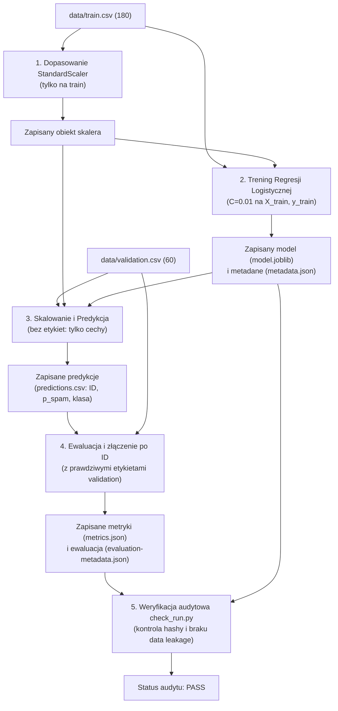

# Sprawozdanie — Laboratorium 2: Od problemu do planu rozwiązania

**Aplikacja i model:** Antigravity · Gemini 3.8 Flash · High  
**Link do repozytorium:** https://github.com/Trerox/MIO  
**Katalog projektu i danych:** `Lab2/project`

---

## 1. Cel i zakres

* **Przeznaczenie prototypu:** Lokalne narzędzie wspomagające klasyfikację przychodzących wiadomości e-mail, działające offline — bez podłączania do zewnętrznej skrzynki pocztowej i bez automatycznego, trwałego usuwania wiadomości. Wiadomości podejrzane mają być oznaczane i kierowane do folderu kwarantanny/spamu do ewentualnego wglądu użytkownika.
* **Wejście modelu:** Pojedyncza wiadomość e-mail. Model przyjmuje wyekstrahowany z niej wektor 6 przygotowanych cech liczbowych opartych na tekście i temacie wiadomości.
* **Wyjście modelu:** Szacowane prawdopodobieństwo przynależności wiadomości do spamu $p\_spam \in [0, 1]$ oraz binarna etykieta decyzyjna: `spam` (gdy $p\_spam \ge 0.5$) lub `ham` (zwykła poczta).

---

## 2. Wybrane podejście i uzasadnienie

### Przygotowanie danych
* **Dostarczony podział:** Wykorzystujemy przygotowany historyczny podzbiór Apache SpamAssassin:
  * `train.csv`: 180 wiadomości (120 ham, 60 spam) — do uczenia parametrów modelu,
  * `validation.csv`: 60 wiadomości (40 ham, 20 spam) — odłożony do weryfikacji.
  Podział ten zachowuje identyczne proporcje klas (stratyfikacja 2:1), co zapobiega zafałszowaniu wyników przez przypadkową dysproporcję.
* **Kompletność i brak wycieku:** Zbiory są rozłączne pod kątem identyfikatorów `message_id`, a znormalizowane duplikaty zostały usunięte na etapie przygotowania danych.
* **Skalowanie cech:** Ponieważ cechy różnią się skalami (np. `capital_run_mean` osiąga wartości rzędu kilkunastu, podczas gdy udziały znaków `dollar_rate` są ułamkami rzędu 0.001), stosujemy standaryzację `StandardScaler`. Wszelkie statystyki skalowania (średnia i odchylenie) są dopasowywane **wyłącznie na zbiorze treningowym**.

### Reprezentacja wiadomości (Decyzja projektowa 1)
* **Wybór:** Reprezentacja oparta na 6 przygotowanych cechach liczbowych:
  1. `free_rate`, `money_rate`, `remove_rate` (częstość słów kluczowych),
  2. `exclamation_rate`, `dollar_rate` (udział wykrzykników i symbolu `\$`),
  3. `capital_run_mean` (średnia długość ciągów wielkich liter).
* **Uzasadnienie wyboru:** Użytkownik zdecydował o pozostaniu przy reprezentacji 6 cech, aby zachować zgodność z przygotowanym potokiem, ograniczyć złożoność obliczeniową i korzystać z łatwo interpretowalnych wskaźników bez konieczności budowania i utrzymywania wielotysięcznego słownika słów.
* **Co reprezentacja zachowuje, a co pomija:**
  * *Zachowuje:* Kluczowe, uniwersalne sygnały socjotechniczne typowe dla spamu (krzykliwe formatowanie wielkimi literami, ponaglanie wykrzyknikami, odniesienia finansowe).
  * *Pomija:* Pełny kontekst semantyczny, gramatykę, szyk zdań oraz alternatywne formy słowne (np. słowo „cents” zamiast symbolu „\$”). Przeprowadzona próba pilotażowa wykazała, że to uproszczenie skutkuje podwyższoną liczbą przeoczeń spamu (FN), lecz jednocześnie nie generuje fałszywych alarmów (FP).

### Wybór modelu i porównanie z alternatywą (Decyzja projektowa 2)
* **Wybrany model:** **Regresja Logistyczna (Logistic Regression)** ze stałym parametrem regularyzacji $C = 0.01$ (regularyzacja L2).
  * *Uzasadnienie:* Uczy się wag dla każdej z 6 cech, optymalizując funkcję straty (log-loss). Regularyzacja L2 zabezpiecza model przed przeuczeniem na małym zbiorze treningowym (180 wierszy). Model zwraca dobrze skalibrowane prawdopodobieństwo $p\_spam$, co pozwala na bezpośrednie sterowanie progiem klasyfikacji.
* **Porównanie z alternatywą — Naiwny Klasyfikator Bayesa dla cech ciągłych (Gaussian Naive Bayes):**
  * *Alternatywa:* Gaussian Naive Bayes zakłada, że cechy ciągłe mają rozkład normalny i są od siebie wzajemnie niezależne przy danej klasie.
  * *Dlaczego wybrano Regresję Logistyczną:* W wiadomościach spamowych cechy są silnie skorelowane (np. wykrzykniki, wielkie litery i słowa o pieniądzach występują łącznie). Naruszenie założenia o niezależności w Naiwnym Bayesie prowadzi do nierealistycznych, nadmiernie pewnych szacunków prawdopodobieństw (skrajności 0 lub 1). Regresja logistyczna nie wymaga założenia o niezależności cech ani ich rozkładzie normalnym i znacznie stabilniej wyznacza płaszczyznę decyzyjną.

---

## 3. Kroki planu i ich zależności

Droga od surowych danych do oceny odpowiedzi modelu składa się z 5 powiązanych kroków:

### Zależności i zachowywane wyniki:
1. **Dopasowanie skalera i modelu:** Wymaga zbioru `train.csv` (cechy + etykiety `label`). Wynikiem jest plik modelu `model.joblib`, konfiguracja `config.json` oraz `metadata.json` z sumami kontrolnymi SHA-256.
2. **Generowanie predykcji:** Wymaga zapisanego modelu oraz zbioru `validation.csv`. **W tym kroku etykiety są odcięte** — model otrzymuje tylko cechy i generuje `predictions.csv`.
3. **Ewaluacja:** Wymaga `predictions.csv` oraz etykiet z `validation.csv`. Łączy rekordy po `message_id` i generuje macierz pomyłek w `metrics.json`.
4. **Audyt:** `check_run.py` sprawdza, czy żaden identyfikator z treningu nie trafił do walidacji oraz czy hashe modelu i danych są spójne.

---

## 4. Planowana ocena (Decyzja projektowa 3)

### Dane do oceny
* Do oceny wykorzystujemy wyłącznie zbiór odłożony `validation.csv` (60 wiadomości: 40 ham, 20 spam). Dane te nie biorą udziału w treningu ani dopasowywaniu wag skalera, co pozwala ocenić faktyczną zdolność uogólniania (*generalizacji*).

### Asymetria kosztów i polityka błędów
W filtracji poczty występuje fundamentalna asymetria kosztów pomyłek:
* **FP (False Positive — fałszywy alarm):** Prawidłowa wiadomość (`ham`) oznaczona jako spam. Jest to **błąd krytyczny** — użytkownik może nie zauważyć ważnej korespondencji służbowej, faktury lub oferty pracy.
* **FN (False Negative — przeoczenie):** Wiadomość śmieciowa (`spam`) trafia do skrzynki odbiorczej. Jest to **błąd uciążliwy, lecz akceptowalny** — użytkownik może usunąć wiadomość ręcznie jednym kliknięciem.

### Miary oceny
* **Macierz pomyłek:** Liczba $TP, TN, FP, FN$ oraz suma błędów ($FP + FN$).
* **Precyzja (Precision):** $TP / (TP + FP)$ — kluczowy wskaźnik pokazujący, jaki odsetek maili wrzuconych do spamu to rzeczywiście spam. Priorytetem jest utrzymanie precyzji bliskiej 100% (brak błędów FP).
* **Czułość (Recall):** $TP / (TP + FN)$ — odsetek wyłapanego spamu.

### Weryfikacja założeń w próbie pilotażowej
Przeprowadzona mała próba pilotażowa na zbiorze walidacyjnym dała wynik:
* Liczba ocenionych wiadomości: **60**
* **$TN = 40$**, **$TP = 6$**, **$FP = 0$**, **$FN = 14$** (suma błędów: 14).
* **Wniosek decyzyjny użytkownika:** Wynik ten potwierdził słuszność założeń: **$FP = 0$ oznacza, że ani jeden legalny e-mail nie wpadł do spamu (100% precyzji)**. Zgodnie z decyzją użytkownika, zachowanie braku fałszywych alarmów przy standardowym progu 0.5 jest w pełni zadowalające, a obecność błędów FN (przepuszczenie 14 spamów) stanowi w pełni akceptowalny kompromis na obecnym etapie prototypu.

---

## 5. Niewiadome i możliwe korekty

| Niewiadoma / Założenie | Podstawa założenia | Sposób weryfikacji | Planowana korekta w razie problemu |
|---|---|---|---|
| **Stabilność zerowego wskaźnika FP na większej próbie** | W próbie pilotażowej uzyskano $FP = 0$ dla 40 maili `ham`. Na tysiącach wiadomości mogą pojawić się fałszywe alarmy. | Sprawdzenie rozkładu prawdopodobieństw $p\_spam$ dla wiadomości `ham` — jak blisko progu 0.5 się znajdują. | Jeśli pojawią się błędy FP, podniesienie progu decyzyjnego z 0.5 do **0.7–0.8**, wymuszając skrajną ostrożność przed kwalifikacją do spamu. |
| **Wysoki odsetek przeoczeń spamu (FN = 70%)** | Analiza maila `6c95b20ac24fd89d` wykazała, że spamerzy omijają słowa kluczowe (użycie słowa „cents” zamiast znaku „\$”). | Inspekcja kolejnych błędów FN pod kątem użytego słownictwa. | Jeśli zespół zażąda wyższej wykrywalności spamu (wyższego Recall), plan zakłada odejście od 6 prostych cech na rzecz reprezentacji pełnotekstowej **TF-IDF** lub rozszerzenie listy słów kluczowych. |
| **Starzenie się danych (SpamAssassin 2003)** | Korpus pochodzi z 2003 roku. Współczesny spam opiera się na linkach do phishingu, tokenach chmurowych i omijaniu filtrów obrazkami. | Uruchomienie modelu na współczesnych próbkach spamu. | Wzbogacenie wektora wejściowego o metadane techniczne (analiza domen w URL, nagłówki SPF/DKIM). |

---

## 6. Podsumowanie

Przygotowany plan precyzyjnie definiuje budowę i ocenę prototypu opartego na 6 cechach liczbowych i regresji logistycznej z regularyzacją L2. Plan opiera się na świadomym kompromisie inżynierskim: bezwzględnym priorytecie ochrony przed fałszywym oznaczaniem prawidłowej poczty ($FP = 0$) kosztem tolerowania części przeoczonego spamu ($FN = 14$), co zostało empirycznie potwierdzone w próbie pilotażowej i zaaprobowane przez decydenta.
